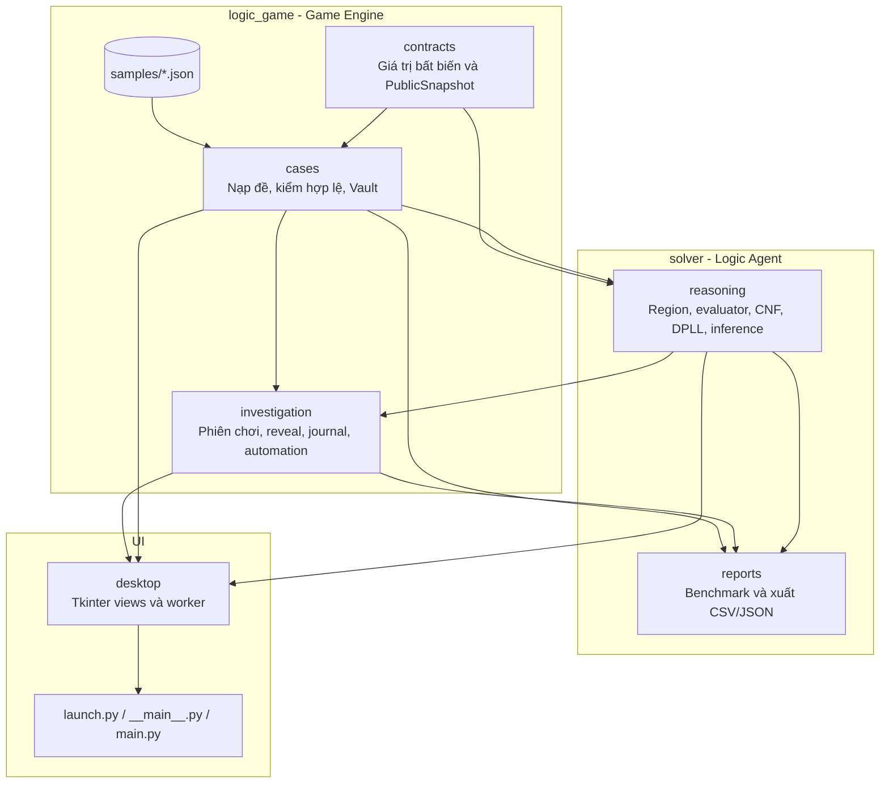
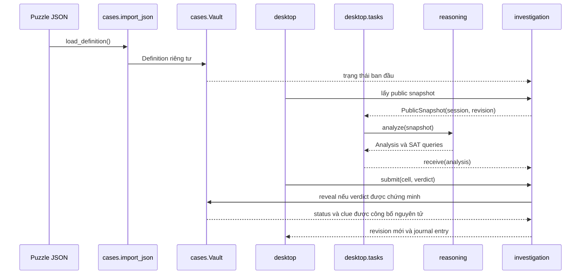

# Kiến trúc Proof Ledger

Tài liệu này mô tả cấu trúc mã nguồn sau khi tách rõ ba miền trách nhiệm: `solver`, `UI` và `logic_game`. Các mũi tên trong sơ đồ là chiều phụ thuộc ở mức mã nguồn.

## Sơ đồ thành phần



`contracts` chỉ dùng thư viện chuẩn. `reasoning` chỉ được phụ thuộc vào `contracts`, không được đọc `Definition`, `Vault`, lời giải hoặc clue chưa lật. `desktop` chỉ gọi solver trực tiếp trong `tasks.py`, nơi tiến trình nền nhận duy nhất một `PublicSnapshot`. `reports` không phụ thuộc Tkinter nên có thể chạy headless.

## Luồng suy diễn



## Cây thư mục

```text
src/proofledger/
├── contracts/       # Verdict, Outcome, Person, Clue, PublicSnapshot
├── cases/           # Definition, JSON loader, catalog, Vault
├── investigation/   # Coordinator, journal, AutoPilot
├── reasoning/       # Region, truth evaluator, CNF, DPLL, inference
├── reports/         # Batch runner, timeout isolation, CSV/JSON export
├── desktop/         # Tkinter UI và tiến trình phân tích nền
├── samples/         # Sáu puzzle JSON mẫu
├── launch.py
└── __main__.py
```

## Bất biến kiến trúc

1. Chỉ `Vault` giữ lời giải và clue chưa lật.
2. `PublicSnapshot` không chứa dữ liệu bí mật và là hợp đồng duy nhất đi vào Logic Agent.
3. Một verdict chỉ được chấp nhận từ `Analysis` cùng `session` và `revision`.
4. Status và clue của một ô được công bố trong cùng một thao tác.
5. Kết quả worker lỗi hoặc đã cũ không bao giờ được diễn giải thành UNSAT hay dùng để reveal.
6. Batch report giữ lại cả lỗi và timeout thay vì loại khỏi kết quả.
